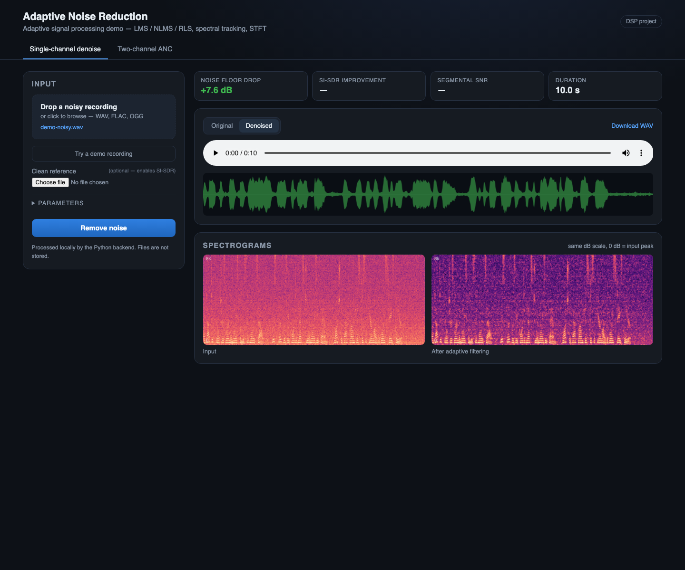
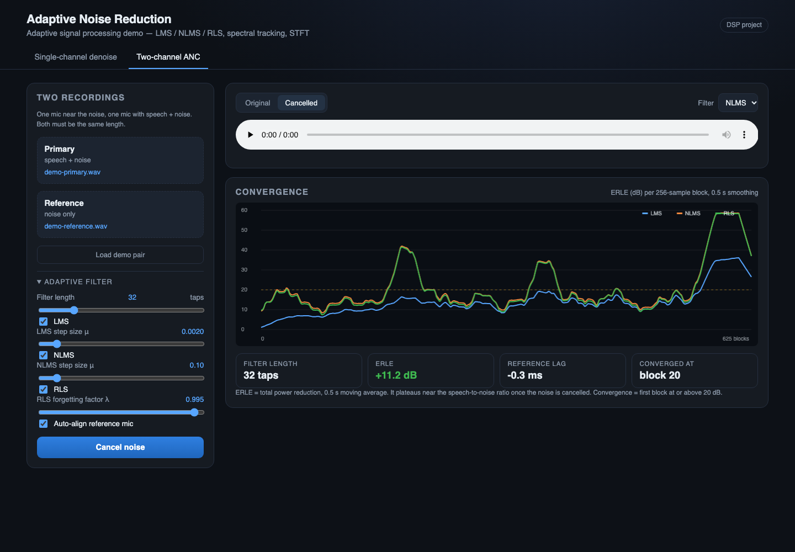
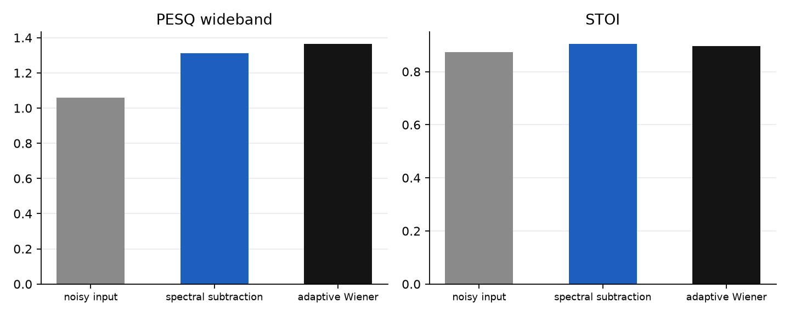
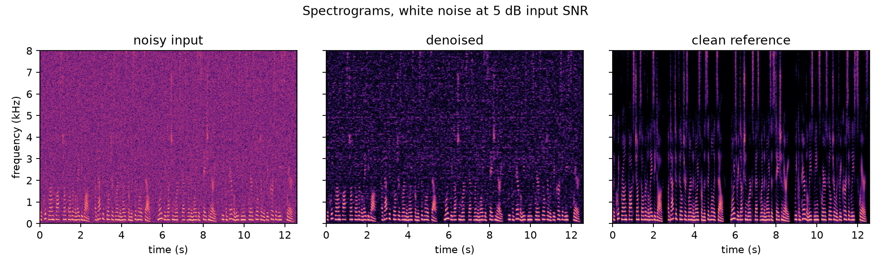
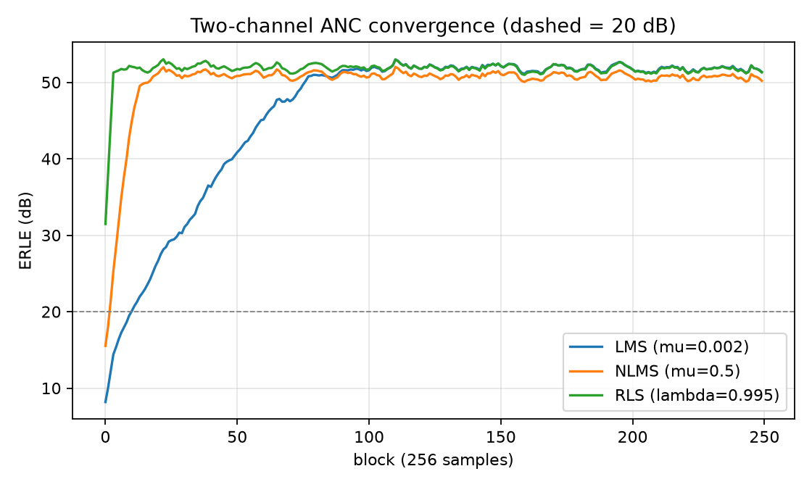
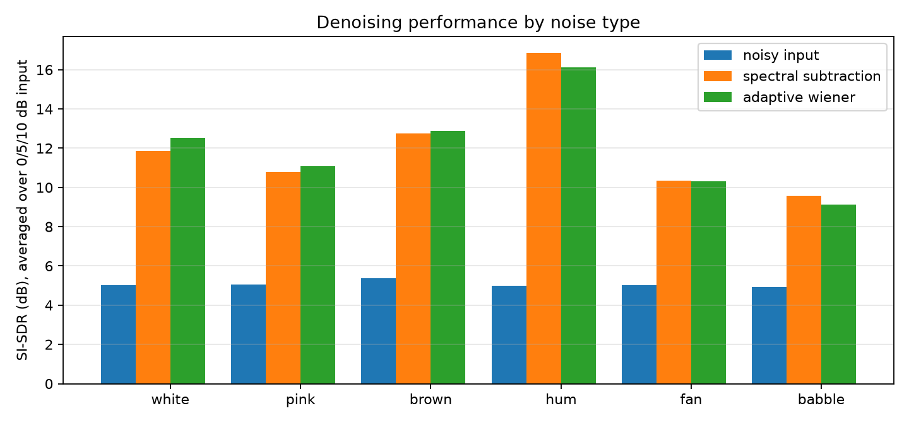

# Adaptive Signal Processing Based Noise Reduction System

Web app that removes noise from audio using adaptive DSP: an LMS/NLMS/RLS noise
canceller for two microphones, and a single-file denoiser built on STFT noise
tracking and a decision-directed Wiener gain. Plain NumPy/SciPy, no ML.
The interface is called **Anechoic**.





## How it works

```
WAV -> mono, DC removal, peak normalise
    -> adaptive notch (2-tap LMS, only if a mains tone is present)
    -> optional adaptive line enhancer (LMS on a delayed copy)
    -> STFT 1024 / hop 256 / sqrt-Hann
         VAD (energy + spectral flatness) -> adaptive noise PSD
         -> decision-directed Wiener gain per bin
    -> ISTFT overlap-add -> cleaned WAV + metrics
```

Two-channel ANC runs LMS, NLMS and RLS filters side by side, aligning the two
microphones by cross-correlation before adapting.

## Quick start

```bash
uv venv --python 3.12 .venv
uv pip install --python .venv/bin/python -r requirements-dev.txt

.venv/bin/python -m pytest -q
.venv/bin/python benchmarks/run_benchmark.py

.venv/bin/python -m uvicorn webapp.app:app --port 8000
# http://127.0.0.1:8000            upload your own audio
# http://127.0.0.1:8000/?demo=1    single-channel demo
# http://127.0.0.1:8000/?demo=anc  two-channel demo
```

## Results

SI-SDR in dB, averaged over 0, 5 and 10 dB input SNR.

| noise  | noisy | spectral subtraction | adaptive Wiener | gain |
|--------|-------|----------------------|------------------|------|
| white  | 5.01  | 11.87 | 12.52 | +7.50 |
| pink   | 5.06  | 10.78 | 11.10 | +6.03 |
| brown  | 5.38  | 12.74 | 12.89 | +7.50 |
| hum    | 4.97  | 16.84 | 16.13 | +11.16 |
| fan    | 5.02  | 10.34 | 10.30 | +5.28 |
| babble | 4.94  | 9.58  | 9.12  | +4.18 |

Two-channel ANC (6 s, fan noise, 32 taps):

| filter           | noisy SI-SDR | clean SI-SDR | ERLE | blocks to 20 dB |
|------------------|--------------|--------------|------|-----------------|
| LMS mu=0.002     | -12.21 | 2.74  | 13.13 | 11 |
| NLMS mu=0.5      | -12.21 | -4.20 | 14.05 | 5  |
| NLMS mu=0.1      | -12.21 | 2.59  | 12.81 | 8  |
| RLS lambda=0.995 | -12.21 | 7.93  | 12.02 | 0  |

Bigger step size converges faster but has higher misadjustment; RLS converges
inside one block at O(N^2) cost.

Perceptual metrics, mean over all noise types and 0/5/10 dB input:

| method | PESQ (wideband) | STOI |
|---|---|---|
| noisy input | 1.06 | 0.874 |
| spectral subtraction | 1.31 | 0.904 |
| adaptive Wiener | 1.36 | 0.896 |

PESQ rewards quality and puts the adaptive gain ahead of plain spectral
subtraction (+0.30 over the noisy input); STOI measures intelligibility and is
essentially tied (0.896 vs 0.904). Both are computed against the known clean
reference, so they only apply to the benchmark, not to uploads.



## Classical pipeline vs a pretrained neural denoiser

RNNoise (a small GRU trained for speech enhancement) was run on the same
mixtures as an offline baseline, resampled to its 48 kHz input and
delay-compensated before scoring. +5 dB input, 6 s of speech:

| noise | method | SI-SDR | PESQ | STOI |
|---|---|---|---|---|
| white | noisy | 5.02 | 1.02 | 0.846 |
| white | classical | **12.72** | 1.11 | 0.869 |
| white | RNNoise | 11.65 | **1.48** | **0.922** |
| fan | noisy | 4.98 | 1.03 | 0.820 |
| fan | classical | **10.09** | 1.17 | 0.861 |
| fan | RNNoise | 9.23 | **1.34** | **0.918** |
| babble | noisy | 4.91 | 1.07 | 0.931 |
| babble | classical | **9.42** | **1.48** | 0.940 |
| babble | RNNoise | 8.06 | 1.40 | **0.959** |

The classical system is more faithful (higher SI-SDR everywhere); RNNoise sounds
better on stationary noise (higher PESQ/STOI), while on babble the classical
method keeps the higher PESQ. That is the honest answer to "why not deep
learning": the learned baseline was measured, not assumed.

```bash
uv pip install pyrnnoise          # optional, benchmark only
.venv/bin/python benchmarks/neural_baseline.py
```







## Deploy free on Render

Render's free web service runs FastAPI directly, no Docker involved.

1. Push the project to GitHub.
2. Render dashboard -> **New +** -> **Web Service** -> connect the repo.
3. Fill in:
   - **Runtime**: Python 3
   - **Build command**: `pip install -r requirements.txt && python -m dsp.warmup`
   - **Start command**: `uvicorn webapp.app:app --host 0.0.0.0 --port $PORT`
   - **Health check path**: `/api/health`
4. Add an environment variable `PYTHON_VERSION` = `3.12.14`
   (a `.python-version` file is already in the repo).
5. Create the service and wait for the first build (~2 min).
6. Open the URL, then `/?demo=1` and `/?demo=anc`. Check `/api/debug` shows
   `"numba": true`.

Notes for the free plan:

- The service sleeps after 15 minutes idle; the first request afterwards takes
  about 30-50 seconds.
- 512 MB RAM is enough: the demo pair processes in ~1 s, uploads are capped at
  40 MB / 120 s.
- The demo speech is bundled in `assets/`, so no macOS-only tools are needed on
  the server.
- The kernels are precompiled at startup and the bundled demo result is shipped
  in `assets/demo-anc.json`, so the first request does not pay the Numba compile
  cost.

### Keep it awake

GitHub Actions pings `/api/health` every 10 minutes
(`.github/workflows/keepalive.yml`), which stops the free instance from sleeping
between demos. GitHub's scheduler is best-effort, so allow a few minutes of
skew. A single always-on free service is 744 hours a month, just inside Render's
750-hour allowance.

### Why not Vercel

Vercel runs serverless functions, not a long-lived ASGI server: 10 s execution
limit on the free plan, size limits with NumPy/SciPy, and no writable disk. Use
Render (or Railway / Fly.io / Hugging Face Spaces) for this backend.

## Project layout

```
dsp/
  framing.py     STFT/ISTFT, sqrt-Hann, exact overlap-add
  lms.py         LMS, NLMS, RLS (with learning curves)
  notch.py       adaptive notch, harmonic cascade, adaptive line enhancer
  noise_est.py   VAD (energy + spectral flatness), noise-PSD tracker
  spectral.py    decision-directed Wiener gain, spectral subtraction baseline
  pipeline.py    end-to-end denoise(), keeps every intermediate signal
  metrics.py     SNR, SI-SDR, ERLE, segmental SNR
  synth.py       reproducible speech and noise generators
benchmarks/
  run_benchmark.py   noise/SNR grid, ANC convergence, figures, summary table
webapp/
  app.py         FastAPI endpoints and reference alignment
  audio_io.py    decoding, WAV encoding, spectrogram payloads
  static/        single-page UI (no build step)
tests/           31 tests across DSP, API and metrics
demo_explain.py  stage-by-stage printout for a viva
```

## Limits

- Single channel needs roughly stationary noise and pauses to learn the noise
  profile; babble and traffic degrade badly.
- ANC needs a correlated reference. Speech leaking into the reference
  (double-talk) pulls the weights; no double-talk detector is implemented.
- The spectral stage keeps the noisy phase.
